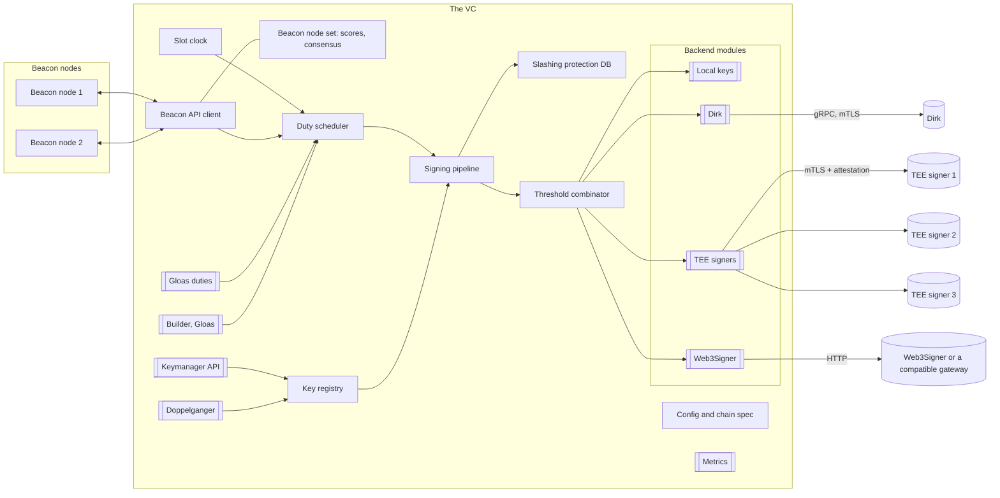

# Eplix design

The design of Eplix, an Ethereum validator client in F#. It was written before the code and is kept as the reference for why the code is shaped as it is; `README.md` describes what the code does today.

Projects are `Eplix.*` and the binary is `eplix`. This document says "the VC" for the validator client; where it names `Vc.*` projects or the `vc` binary, read `Eplix.*` and `eplix`. "TEE signers" are the signers of the tee-signer project: runners in a trusted execution environment (Azure confidential containers, AWS Nitro Enclaves, GCP Confidential Space) that each hold a whole key or one share of a key.

"est." marks an estimate. Every other number comes from a cited run, file or spec.

## Contents

1. Goals and non-goals
2. Architecture
3. The signing backend interface
4. Threshold signing
5. The four backends
6. Slashing protection
7. Keys, migration and leaving
8. Duties, timing and load
9. Builders and Gloas
10. .NET and F# choices
11. Reuse from Nethermind
12. Testing
13. Risks
14. Design choices
15. Sources

## 1. Goals and non-goals

### Goals

1. A validator client in F# that performs every duty of a validator on Fulu and Gloas networks.
2. Threshold signing out of the box: the VC sends each typed request to n signers, takes m partial signatures and combines them, as Vouch does with Dirk distributed accounts.
3. Four signing backends behind one interface: local keys, Dirk, TEE signers, Web3Signer. A new backend is one module that implements the interface.
4. Whole keys and threshold keys in one VC at the same time, so an operator can migrate from another client and later move keys to threshold signers without a second VC.
5. A small core. Everything the core does not need to attest and propose safely is a module that the build can leave out.
6. One NativeAOT binary per platform, few dependencies, each pinned.
7. Lessons from load tests of threshold signers built in: attestation bursts, typed refusals, restart floors on signers, key reload without restart, slashing protection in the VC and in the signers.
8. Performance targets (10.4), measured with benchmarks (`benchmarks/Eplix.Bench`) and on a devnet (12.5).
9. Several beacon nodes at once, in the core: attestation data only when a threshold of nodes agrees on it, so one bad or lagging node cannot make the validators vote for its view (8.4, after Vero).

### Non-goals

- No beacon node. The VC talks to any beacon node over the standard Beacon API.
- No key generation and no DKG in this version. Threshold signers make their keys with their own tools. The VC imports existing whole keys and uses existing remote keys.
- No deposits in this version. Operators use their existing deposit tools.
- One VC coordinates its validators; high availability is in section 14.
- No web UI in this version.

### What is core and what is a module

| Core (always built) | Module (can be left out) |
| --- | --- |
| Config and chain spec | Local key backend |
| Slot clock and duty scheduler | Dirk backend |
| Beacon API client, several nodes with attestation consensus | TEE signer backend |
| Signing pipeline with priorities | Web3Signer backend |
| Threshold combinator | Keymanager API (on in the default build, see section 7) |
| Slashing protection with EIP-3076 interchange | Metrics endpoint |
| Key registry | Remote key list polling |
| BLS (sign, verify, aggregate, Lagrange) | Doppelganger protection |
| SSZ and JSON codecs for what the VC signs | Obol mode (combined selection proofs, for a Charon cluster) |
| SSZ and JSON codecs for what the VC signs | Validator monitor (inclusion, votes, balances on chain) |
| | Builder module (Gloas) |
| | Pre-Gloas builder flow (legacy builder module, off by default) |
| | Gloas duties (required on a network with Gloas scheduled) |
| | Exit command |

A VC needs at least one backend module. The local backend is in the default build. Gloas duties are a module so a Fulu-only build stays small, but the VC refuses to start on a chain config that schedules Gloas without them.

## 2. Architecture



Double brackets mark modules. The path for one attestation:

1. The scheduler wakes at the attestation time of the slot, or earlier when the head event for the slot arrives.
2. It asks the beacon node (or the multi-node strategy) for `AttestationData`.
3. For each validator with a duty in that slot, the pipeline builds a typed request.
4. Slashing protection checks all requests of the burst and writes their marks in one append and one fsync.
5. The pipeline hands each request to the key's route: one backend for a whole key, the threshold combinator for a threshold key.
6. The combinator fans out to n backends, collects m partials, combines and verifies.
7. The pipeline submits the signed attestations to the beacon node(s) in one call.

### Core components

| Component | Job |
| --- | --- |
| Config | One JSON file plus flags and environment variables. Strict: unknown fields fail the start. Chain spec from the beacon node (`/eth/v1/config/spec`) is checked against a pinned chain config file; a mismatch fails the start. Domain types are constants of the specs, never read from the node. |
| Slot clock | Slot and epoch from genesis time and slot duration, pinned for the built-in networks and the same on every node otherwise. Uses `TimeProvider`, so tests run on a fake clock. Deadlines come from the spec's basis-point fields (`ATTESTATION_DUE_BPS_GLOAS` and peers). |
| Beacon API client | HTTP with keep-alive, SSE events, SSZ for blocks where the node supports it, JSON elsewhere. Several nodes in the core (8.4); one node is the 1-of-1 case. |
| Duty scheduler | Fetches duties for the current and next epoch, refetches when `threshold` nodes' head events show a new dependent root, runs each duty at its time. |
| Key registry | Each key's state, route, fee recipient, gas limit, graffiti and source. Section 7. |
| Slashing protection | High-water marks per key with group commit, EIP-3076 import and export. Section 6. |
| Signing pipeline | Typed requests, two priority classes, deadlines, coalescing of identical non-slashable requests, submission. Section 8. |
| Threshold combinator | m of n over any backends. Section 4. |
| BLS | Sign, verify, fast aggregate verify, Lagrange combination in G2. Wraps `Nethermind.Crypto.Bls` (section 11). |
| Codecs | SSZ and JSON for the containers the VC builds, checks or signs. |

### How modules plug in

NativeAOT cannot load assemblies at run time, so "plug out" means build time. Each module is its own project that exposes one value:

```fsharp
type Module =
  { Name: string
    Configure: ConfigSection -> Result<unit, string>
    Start: CoreServices -> CancellationToken -> Task<ModuleHandle> }
```

The host project lists the modules it links. An MSBuild property per module (for example `-p:VcDirk=false`) drops the project reference, and trimming removes its code. The default build links the local, TEE, Web3Signer and Dirk backends, the keymanager API, metrics and Gloas duties. A `minimal` profile links only the local backend.

## 3. The signing backend interface

### Typed requests

Backends receive the whole message, never a bare signing root. A backend that keeps its own slashing protection (Dirk, Web3Signer, TEE signers) can then apply its rules, and the TEE signers require it: they sign typed messages only.

```fsharp
type Duty =
  | Attestation of AttestationData
  | Block of BeaconBlockHeader                 // the VC computes body_root itself
  | RandaoReveal of Epoch
  | AggregationSlot of Slot                    // selection proof for attestation aggregation
  | AggregateAndProof of Fork * AggregateAndProof  // hash_tree_root differs in Gloas
  | SyncCommitteeMessage of Slot * Root
  | SyncSelectionProof of Slot * subcommittee: uint64
  | ContributionAndProof of ContributionAndProof
  | VoluntaryExit of VoluntaryExit
  | PayloadAttestation of PayloadAttestationData   // Gloas PTC vote
  | PayloadEnvelope of ExecutionPayloadEnvelope    // Gloas self-build
  | ProposerPreferences of ProposerPreferences     // Gloas
  | BuilderRequestAuth of BuilderRequestAuth       // Gloas builder API, out of protocol
  | ValidatorRegistration of ValidatorRegistrationV1 // only if the legacy builder module exists

type SignRequest =
  { Key: PubKey                // the validator key; a share backend maps it to its share
    Duty: Duty
    Fork: ForkInfo             // fork version and genesis validators root
    Domain: Domain             // computed by the VC; TEE signers recompute and compare
    Priority: Priority         // High | Low
    Deadline: DateTimeOffset }
```

### Results and refusals

```fsharp
type Refusal =
  | Slashable of string        // never retried; an alarm if the VC's own DB allowed it
  | PolicyDenied of string     // never retried
  | NotReadyUntil of Epoch voption  // restart floor, no trusted time, setup pending
  | UnknownKey                 // triggers a key refresh of that backend
  | Unsupported of DutyKind    // the duty is routed elsewhere or turned off
  | DomainMismatch             // config alarm: chain or fork schedule differs
  | BadRequest of string       // a bug in the VC

type Failure = Timeout | Transport of string | Internal of string

type SignOutcome =
  | Signed of BlsSignature                        // full signature for Key
  | Partial of shareIndex: uint64 * BlsSignature  // one share, for the combinator
  | Refused of Refusal
  | Failed of Failure
```

A refusal is an answer, not an error. Each backend module maps its native codes to these cases: the TEE runner's status codes, Web3Signer's HTTP codes (412 for slashing), Dirk's `ResponseState` values. The pipeline acts on the case:

| Case | Pipeline action |
| --- | --- |
| `Slashable` | No retry. If the VC's own DB allowed the request, raise the divergence alarm and stop slashable duties for that key until the operator clears it. Another VC with the same key is the likely cause. |
| `PolicyDenied` | No retry. Alert with the reason. |
| `NotReadyUntil e` | Mark the backend "not ready for slashable duties until epoch e". Non-slashable duties still go to it. Inside a threshold this is normal after a signer restart. |
| `UnknownKey` | Refresh that backend's key list now. |
| `Unsupported k` | Turn duty kind k off for that backend and log once. |
| `DomainMismatch` | Alert as a configuration error. No retry. |
| `BadRequest` | Log as a bug. No retry. |
| `Failed Timeout`, `Failed Transport` | Retry on another connection while the deadline allows. For attestations and blocks only an exact repeat is retried, which signers sign again. |

### Capabilities and health

```fsharp
type Capabilities =
  { Duties: Set<DutyKind>
    TypedOnly: bool            // refuses bare roots (TEE signers)
    EnforcesSlashing: bool
    ReturnsPartials: bool
    MaxInFlight: int }

type Health =
  | Up
  | Degraded of string
  | NotReadyUntil of Epoch
  | Down of string

type KeyEntry = { Key: PubKey; Share: (uint64 * PubKey) voption }

type Backend =
  { Name: string
    Capabilities: Capabilities
    Keys: CancellationToken -> Task<KeyEntry list>
    Health: CancellationToken -> Task<Health>
    Sign: SignRequest -> CancellationToken -> Task<SignOutcome>
    Dispose: unit -> ValueTask }
```

A record of functions, not an interface: a test builds a fake backend in a few lines, and wrappers (metrics, tracing, the threshold combinator) compose as plain functions. A batch call (`SignMany`) can be added later as an optional field when a backend supports it (a batch request of the runner protocol, for example).

## 4. Threshold signing

The combinator is a function from m and n members to a `Backend`:

```fsharp
type Member = { Backend: Backend; Index: uint64; Budget: TimeSpan }
val threshold : m:int -> members: Member list -> bls: Bls -> Backend
```

The members can be any backends that return partials for the same key: n TEE signers, the n Dirk instances of a distributed account, Web3Signer instances that hold shares (as in a Charon cluster), local shares in tests, or a mix.

Behaviour of `Sign`:

1. Send the request to all n members at once. Waiting for m first and asking more on failure would add a round trip to every slow case.
2. Each member gets its own timeout, the smaller of its budget and the request deadline.
3. When m partials have arrived, combine them by Lagrange interpolation at zero, then verify the result once against the validator key. That costs one pairing check per request instead of m + 1 for checking each partial and the result.
4. If the combined signature fails, verify each partial against its share key, drop the bad ones, and wait for further partials. Log the bad member.
5. If refusals make m partials impossible (more than n - m refusals), answer at once with the merged refusal. `Slashable` wins over the other cases.
6. Stragglers:
   - For attestations, blocks, PTC votes and envelopes, the VC does not cancel the requests in flight. They finish in the background up to their timeout, so every signer records the vote and the signers' marks stay level. A signer that missed a vote plus a rolled-back one would form a slashable pair under a hostile coordinator.
   - For non-slashable kinds, requests still queued for a member are dropped once m partials are in.
7. Lagrange coefficients depend only on the set of indices. The combinator caches them per set.

`blst` provides the scalar and G2 operations this needs: `Scalar` add, multiply and inverse, `P2.Mult`, `P2.Add` and `MultiMult`, all exposed by `Nethermind.Crypto.Bls` (section 11).

Where the members and their share keys come from (config, key lists, at start and at every refresh), never per request:

- A group needs 2m > n: with 2m <= n two sets of m members share no member, and each could sign a different message for one slot with every member's protection allowing it. The TEE and Web3Signer configs fail the start; a Dirk distributed account at such a threshold is refused until restart.
- Every share key must lie on one split of the validator key: m of them combine to it, and each other one combines to it with m - 1 of those. A key whose shares do not is refused until restart, with the members named.
- A key whole on one backend and split in a group signs on neither route; the registry refuses it until restart, whichever modules list the two routes and in whichever order. No key goes active before every module has started, so at start the first route cannot sign before the second one shows. A signer that lists a key it does not hold can so take the key out until restart; the error names both routes. A Dirk instance describes only distributed accounts it is a participant of; others it lists are ignored.

Health of a threshold backend: `Up` when at least m members are up, `Degraded` when exactly m are, `Down` below m. A member that answered `NotReadyUntil` counts as down for slashable kinds until that epoch.

## 5. The four backends

### 5.1 Local keys

- Reads EIP-2335 keystores (section 7.2 for layouts). Key derivation: PBKDF2-SHA256 is in .NET (`Rfc2898DeriveBytes.Pbkdf2`); scrypt is not, so the module carries an scrypt implementation checked against RFC 7914 and the EIP-2335 test vectors. AES-128-CTR is built on the in-box AES. scrypt limits: V (128 * r * n bytes) up to 1 GiB, so n = 2^20 with r = 8 passes; r up to 32 and p up to 16, which bound the other buffers (128 * r bytes each, p + 3 of them, about 76 KiB at the caps); r * n * p up to 2^23 (about 4 s on one core). A keymanager import decrypts outside the backend's lock and stops when the request is cancelled.
- A keystore or password file that cannot be read (permissions, removed during the check) fails only that key. It costs no scrypt, gets no stamp, and the next directory check tries it again; the warning shows once per error. A keystore skipped because another file already holds its key loads at the next check once that file is gone.
- Keys stay in pinned memory as `blst` secret keys and are zeroed on removal.
- Signs in the VC process. The VC's slashing protection is the only protection for these keys.
- Can also hold shares, which the threshold tests use.

### 5.2 Dirk

- gRPC over mutual TLS, the `eth2-signer-api` protocol as Vouch uses it. The module carries the generated client for the Dirk protos at a pinned commit, through `Grpc.Net.Client` and `Google.Protobuf`.
- Accounts come from Dirk's lister. A distributed account names its participants and threshold, so the module turns it into a threshold combinator over one member per participant.
- Stock Dirk has typed calls for attestations and proposals and a generic `Sign` (root plus domain) for the other kinds. The module uses the typed calls where they exist. For the rest it computes the root itself, which is what Vouch does. Its capabilities say so, and the registry never routes a key that needs typed-only signing to it.
- Dirk refuses a batch with two requests for one key. The module splits batches per key.
- Health: `Down` after a transport error, `Degraded` after a call that timed out, `Up` again at the next answer of any kind (a refusal counts as an answer). A timeout is not `Down`, because a threshold group that cancels its stragglers also ends their calls as timeouts.
- The Dirk server certificate must carry the serverAuth extended key usage, as must a Web3Signer's (5.4): a client certificate from the same CA does not pass as a server.
- A whole-key signature goes back to the pipeline at once and is verified in the background. A bad one is logged and counted. Three in a row stop the key at that instance, refused as by a signer that is down, until a RANDAO reveal probe verifies (once an epoch), the key list registers the key anew, or the VC restarts. Partials are verified when the group combines them.
- Typed calls beyond stock Dirk are not a target, except four Gloas calls (PTC vote, envelope, proposer preferences, builder request auth) that a Dirk build with Gloas support offers and that such a build denies as a generic `Sign`. Stock Dirk answers them UNIMPLEMENTED, and the module then sends those kinds to that Dirk as root and domain. `gloas_calls` (`auto`, `typed`, `generic`) fixes the choice instead.

### 5.3 TEE signers

The VC talks to n TEE signers directly and combines m of n partials itself, with no gateway or Dirk in between. Nothing fixes n or m: they come from each threshold key's config (2 of 3 is the common case; the tests cover 3 of 5 and 5 of 7), and different keys may use different groups.

- Protocol: the runner's framed protocol over TLS 1.3 with a client certificate, as tee-signer documents it, in frame version 1, the only one tee-signer speaks.
- Every connection: TLS handshake, IDENTITY with a fresh nonce, attestation check, setup pins, TLS key hash equal to the handshake key. Only then any request. The steps follow tee-signer's own client (`attestation-verify/runnerclient`).
- Duty kinds map to the runner's SIGN kinds. RANDAO goes as kind 5 with `object_root = hash_tree_root(epoch)`, which the signer checks. Builder request auth is kind 14 (section 9.3).
- The client certificate holds the signing role. Section 14 covers the attestation verifier.
- Connection pool per signer, K connections (default 8, est.), dialed and attested at start and kept warm. A new attested connection to a GCP signer took 9 s at p50 and up to 30 s under load in a load test, so the module never dials on the request path. A broken connection is redialed in the background with backoff (1 s doubling to 16 s). A connection lost within 5 s of its dial, before it served a request, counts as a failed dial, so a runner that accepts the handshake and then drops the connection is not redialed in a tight loop. A connection that breaks while idle leaves the pool at once.
- Priority inside the pool: attestations, blocks, RANDAO, PTC votes and envelopes first; every 8th free connection serves the low class while it waits .
- Key list: PUBLIC_KEYS at start and every epoch. One frame holds about 10,082 keys and the answer has no paging, so one runner serves at most that many keys to one VC.
- No security property depends on the network. Addresses are config; trust comes from mutual TLS and attestation.

What the attestation check buys the VC: the signer's share key never leaves its TEE, and a partial that does not verify against the share key is dropped anyway. The check tells the VC that the signer it talks to runs an allowed image under the pinned setup, so its slashing protection and policy are in force, and it keeps a stranger from reading the VC's requests. It matters, but less than the TEE key release does.

### 5.4 Web3Signer

- EIP-3030 remote signing API: `POST /api/v1/eth2/sign/{identifier}` with `type`, `fork_info` and the typed object, `GET /api/v1/eth2/publicKeys`, `GET /upcheck`. Gloas types per remote-signing-api v1.4.0.
- HTTP 412 maps to `Slashable`, 404 to `UnknownKey`, 400 to `BadRequest`.
- Two modes: whole keys (identifier is the validator key) and shares (identifier is the share key, the result is a `Partial`).
- Whole-key signatures are verified in the background, with the same stop and probe as Dirk (section 5.2).
- With a CA file, the server certificate must carry the serverAuth extended key usage.
- A gateway in front of threshold signers can speak this API, so the VC can sign through such a gateway with no change to the signers.

## 6. Slashing protection

### 6.1 Rules

The VC keeps, per key, high-water marks in the EIP-3076 "minimal" sense:

- block: highest signed slot, and the signing root of that block;
- attestation: highest source epoch and highest target epoch, and the signing root of the last vote;
- Gloas: highest PTC vote slot and root, highest envelope slot and root (not slashable on chain, but a threshold coordinator must not produce two of them for one slot). These live in `slot-marks.db`, apart from `slashing.db`; a refusal skips the duty and never halts the key, and a key needs no imported history for them.

A block is allowed if its slot is above the mark, or equal with the same signing root. An attestation is allowed if its source is at or above the source mark and its target above the target mark, or it repeats the last vote exactly. The marks never go down. These rules refuse a few votes a full-history checker would allow; they never allow one the full-history checker refuses. Section 12 tests that claim.

### 6.2 Storage

The marks live in an append-only log with fixed-size records (key index, kind, values, root, CRC32C), plus a snapshot written at start and every few epochs (est. every 8). At start the VC loads the snapshot and replays the log.

Write order: check, append, fsync, then send to the backend. A crash after the fsync and before the send leaves a mark for a vote nobody signed, which is safe.

A failed append or fsync poisons the DB: no later write lands, and each writer checks that again under the append gate, since another write may have failed after its own check. The burst whose write failed gets no signature: both its `Allowed` requests and its exact repeats are refused, because a repeat may match a mark that an `Allowed` request earlier in the same burst set and that is not on disk. The slot marks file follows the same rules.

Group commit: the pipeline checks a whole burst (every attestation of a slot) and writes all its marks with one append and one fsync. A load test showed why per-vote writes matter: a signer's attestations queued with the CPU idle, and the cause was its per-vote fsync. The VC must not repeat that.

Per-key locks are taken in sorted key order without a global mutex while waiting (a global mutex held while waiting deadlocked Dirk under load).

### 6.3 Interchange

EIP-3076 import and export, both formats on import (complete and minimal), minimal on export. Import merges by taking the maximum per field and never lowers a mark. Section 7 gives the rules for keys without imported history.

### 6.4 With signers that keep their own protection

The VC's DB is the first line; a remote signer's protection is the last. Both run:

- TEE signers check every request against their own marks. The VC cannot weaken that, and the signers do not trust the VC.
- Dirk and Web3Signer keep their own databases.
- A remote refusal with a slashing reason that the VC's DB allowed is a divergence. Section 3 gives the action.
- Restart floors: a restarted TEE signer refuses votes and blocks until its floor epoch passes, with FLOOR or FLOOR_UNPROVEN (status 1008 or 1009) and the floor epoch at the start of the detail. A slashing code is always a conflict and halts the key. The combinator treats that signer as down for slashable kinds until then (section 4). With 2 of 3 and one signer in its floor, the other two carry the duties.

## 7. Keys, migration and leaving

### 7.1 The key registry

Each key has a route: one backend (local, Dirk, Web3Signer, a single TEE signer) for a whole key, or a threshold combinator for a threshold key. Whole and threshold keys live side by side in one registry, one slashing DB and one scheduler.

Key states:

```
discovered -> history-checked -> doppelganger-wait -> active -> draining -> removed
                                                    \-> halted (divergence alarm)
                                                    \-> slashed (the chain shows a slashing)
```

- `history-checked`: the key has a slashing record, imported or explicitly started empty (7.3). A key never signs before this state. Grandine lost votes because keys from its signer refresh never entered its slashing protection; the state machine rules that out.
- `doppelganger-wait`: only when the doppelganger module is on for that key (7.5). No key leaves `history-checked` before every module has started, so a keymanager import or a key refresh during the start waits for the module's hold.
- `removed` keeps a tombstone, so an exported key never signs again in this VC.
- `slashed`: the head state of `threshold` nodes (or of every node that answers) shows the validator slashed. The key signs nothing more, the state is kept in the data dir across restarts, and only draining or removal leaves it. Slashing events from the nodes start an early check, never a stop on their own.

Key sources: local keystore directories, the keymanager API, each backend's key list. The registry polls the remote sources every epoch (configurable) and on demand. A gateway that read its key list once at start missed new keys until a restart; the VC never caches a key list without a refresh. A key that every member holding it answers without, two polls in a row, is drained and removed; a failed or empty answer never counts, and a retired key that is listed again passes the history check again. Nimbus, Prysm and Lodestar also poll their remote signer for keys (from their docs, not re-checked).

### 7.2 Import of whole keys

EIP-2335 keystores, from the layouts other clients write where practical:

| Source | Layout read | Notes |
| --- | --- | --- |
| staking-deposit-cli, ethstaker-deposit-cli | `keystore-m_12381_3600_<i>_0_0-<time>.json`, one password | |
| Teku | `--validator-keys` pairs: `<name>.json` with `<name>.txt` | |
| Lighthouse | `validators/<0xpubkey>/voting-keystore.json`, passwords in `secrets/<0xpubkey>` or in `validator_definitions.yml` | |
| Nimbus | `validators/<0xpubkey>/keystore.json`, `secrets/<0xpubkey>`; `remote_keystore.json` for remote keys | remote entries become Web3Signer keys |
| Lodestar | `keystores/<0xpubkey>/voting-keystore.json`, `secrets/<0xpubkey>` | |
| Prysm | its wallet is one encrypted file, not EIP-2335 per key | the operator runs Prysm's `accounts backup` to get EIP-2335 files first |
| Vouch | ethdo wallet stores, or Dirk | wallet stores later if asked; Dirk accounts go to the Dirk backend |

The layouts are as each client documents them; the tests check each against a sample directory written by that client (`tests/fixtures/layouts`). The `vc import` command and the keymanager API do the same import.

### 7.3 Import of slashing history

- `eplix import` takes an EIP-3076 file next to the keys (`--slashing-protection`). The keymanager `POST /eth/v1/keystores` takes it in its `slashing_protection` field, as the API defines.
- Safety rule: a key signs only with a slashing record, and no beacon node data gives it one. Beacon node data can only raise a floor, never lower one, and it is bounded: a head more than one epoch past the wall clock refuses the whole floor (below). A key with no record stays `discovered` and never signs, whatever status the nodes show. The log says once per key how to give it a record.
- A key with no history at all (a new validator, or a lost setup: keys made again from the mnemonic after a disk loss) gets a floor record (`Slashing/Floor.fs`). With E the epoch now, the floor is source = target = E + 1 and a block mark at the last slot of epoch E + 1, with no roots; the PTC vote and envelope marks go to that slot too. E is the clock's epoch from the pinned genesis (for a chain config file, the genesis the nodes agree on), raised by the head slot of any configured node; a node only raises it. A head more than one epoch past the clock's epoch writes no floor at all, on both paths below: the import exits with an error, and the override logs one and leaves the keys `discovered` until a later refresh. No honest node is that far ahead of a correct clock, and a floor far ahead would stop the key for good. Dropping only that head would not be safe either: when the system clock is behind, the far head is the true one, and a floor without it could sit below epochs the key signed elsewhere. The error says to check the system clock and the nodes. Every signature the key made before is at or below E, so nothing the VC signs above the floor is slashable with one of them, as long as no other machine signs with the key now. A key that already has a record keeps the higher of each mark. Two paths write a floor:
  - `eplix import --no-signing-history`, before the VC starts. It asks every configured node for each key's status. A key that a node shows `active_*`, `exited_*`, `withdrawal_*` or slashed may have signed, so the import asks on the terminal (`[y/n/all]`) and names the status, the node and the floor epoch. Pending and unknown keys need no question; only nodes that are neither syncing nor optimistic count. When no such node answers, it says so once and asks for every key as status unknown. E is read again after the last answer and the higher value is written, since the old machine may sign while the operator answers. A key whose keystore is already in the data dir and has no slashing record takes part too, without a new copy; keys are copied only after the floor is written, and only those whose password was read before the question. Without a terminal it imports none of those keys, lists them and exits 1; no flag answers yes for the operator. Origin `Floor`.
  - The `allow_start_without_history` override (per key, or `all`), at a key refresh of the running VC. It writes the same floor (origin `StartedEmpty`), never an empty record, and logs each key.
- A keymanager import without `slashing_protection` leaves the key `discovered` (no floor, no start); the response message says why. An EIP-3076 entry with no signed block and no signed attestation gives a new key no record either (every import path: `eplix import`, `eplix slashing import`, the keymanager): some setup tools write such files to skip protection, and an empty record would start the key with no floor. A key the override lists still gets its floor at the next refresh.
- Cost of a floor: the key attests only once the justified checkpoint is at E + 1 or later, about 2 to 3 epochs when the chain finalizes, and longer under non-finality, until justification passes the floor. It proposes only after epoch E + 1. A new key imported right after its deposit, long before it activates, loses nothing.
- Threshold keys made by a DKG are new keys: they start through the override, with a floor. Their signers keep their own marks from the first signature.

### 7.4 Remote keys

Keys already in a Web3Signer stay there. The keymanager `POST /eth/v1/remotekeys` adds them with the signer URL; they route to the Web3Signer backend. Web3Signer's own database stays in force, and the VC still needs the old VC's interchange for its own DB (7.3).

### 7.5 Doppelganger check

The doppelganger module asks every beacon node's liveness endpoint (`POST /eth/v1/validator/liveness/{epoch}`) for each key and holds the key back while any liveness appears, for 2 epochs by default (configurable). On by default, and every key waits at every start: a pass kept in the data dir would travel with a copy of it. For threshold keys behind TEE signers it is optional: the signers' marks protect them, but a whole copy of the key elsewhere (for example a whole key kept by the dealer that split it) would not be stopped by them. Cost: the key misses its duties for those 2 epochs, and one more, since the check reads each epoch at the end of the next one. A key that leaves the VC and comes back waits again. An epoch in which the node has no index for the key does not count. Each start, restart or upgrade misses 3 to 4 epochs of duties with the default of 2 epochs.

### 7.6 Keymanager API

The standard keymanager API, so existing tooling works: `/eth/v1/keystores` (list, import with slashing protection, delete with export), `/eth/v1/remotekeys`, and the per-key fee recipient, gas limit, graffiti and voluntary exit endpoints. Bearer token from a file, as the API describes. It is a module, on in the default build: migration depends on it. One import request takes at most 1,000 keystores, and imports and the directory check decrypt one batch at a time. The server checks the token from the headers before it reads a body, and each route has a body limit: `max_import_bytes` (default 256 MiB, also the server's outer bound) for a keystore import, 1 MiB for deletes and remote key imports, 4 KiB for the rest. The import reads its body as a stream and reduces the `slashing_protection` history to one mark per key as it reads, for at most `max_import_keys` (default 100,000) distinct keys; the delete exports the minimal form. A delete runs to the end once it started, also when the client goes away, so no keystore is gone without its history in the answer.

The per-key settings the API writes live in `key-settings.json` in the data dir. At start each value must pass the rule the API setter applies (a 20-byte fee recipient, a gas limit above 0, a graffiti of at most 32 bytes); a file that does not read, does not parse or holds a bad value fails the start, as a bad proposer config file does. GET, POST and DELETE of a setting for a key the VC does not hold answer 404, so no setting is stored for an unknown key.

The keymanager and metrics servers read no host configuration: no `appsettings.json` from the working directory, no environment variables such as `Kestrel__Endpoints__X__Url`, no command line. Such a variable would add a listener next to the configured one, without its TLS or client certificate check.

The core also reads an operator-written proposer config file (Teku's layout: defaults and per-key fee recipient, gas limit and graffiti) and reads it again each epoch. Per field, the file's entry for the key wins over the API's setting, which wins over the file's defaults and then the config defaults. The API answers 403 to writes for keys the file lists.

### 7.7 Leaving

- `vc export` and keymanager `DELETE /eth/v1/keystores` first move the keys to `draining`: no new duties start, signatures in flight finish. A request counts as in flight from before its slashing check, not only from its backend call, and the backend call checks the key's state again, so a drain that starts between the two either waits for the request or sees it refused. Then they write the interchange for those keys and return or copy the original keystore files. The VC keeps the original keystore JSON from import, so it never re-encrypts a key.
- The tombstone keeps the key from signing again in this VC.
- A threshold key has no whole key to export. Leaving means the interchange from the VC plus a handover of the signers, with the signers' own tools.

## 8. Duties, timing and load

### 8.1 Duties and times

| Duty | Time in the slot (Fulu) | Time (Gloas) | Source |
| --- | --- | --- | --- |
| Block proposal | 0 | 0 | consensus-specs |
| Attestation | 1/3, or when the block arrives | 25% (`ATTESTATION_DUE_BPS_GLOAS`) | `validator.md` |
| Sync committee message | 1/3 | 25% | |
| Aggregate | 2/3 | 50% (`AGGREGATE_DUE_BPS_GLOAS`) | |
| Sync contribution | 2/3 | 50% | |
| PTC vote | n/a | after the envelope is seen, by 75% (`PAYLOAD_ATTESTATION_DUE_BPS`) | |
| Self-built envelope | n/a | by 50% (`PAYLOAD_DUE_BPS`) | |
| Proposer preferences | n/a | each epoch, for the next epoch's proposal slots | |

Gloas times from consensus-specs `specs/gloas/validator.md` at master `065bcd5` (2026-10-22). The VC reads the BPS values from the chain spec instead of hard-coding them.

### 8.2 Lessons from load tests, built in

| Lesson | Source | In the VC |
| --- | --- | --- |
| Each slot's attestations reach the signer as one burst, about 94 requests per signer at 2,880 keys | a threshold signer load test | Two priority classes in the pipeline and in each TEE pool; attestations never wait behind selection proofs. |
| A FIFO queue drains a burst of n in about n × r / K | queueing estimate | K connections per signer, kept warm; requests sent ahead when protocol v2 allows. |
| Grandine sent each sync selection proof 5 to 6 times a slot | seen in a load test | One sync committee member per validator with the set of its subnets, as Vouch fixed in 1.13.0; coalescing of identical in-flight non-slashable requests by (key, kind, signing root). |
| Lighthouse spreads selection proofs by computing them a slot ahead | Lighthouse code | Sync selection proofs for slot s + 1 are signed in the low class after slot s. Within the signers' clock bound (`max_epochs_ahead` 1 on the testnet config). |
| Attestation aggregation selection: one failed call lost a whole epoch's aggregations in Teku; Lighthouse skipped slots | client issue reports | Selection proofs per duty slot, each retried until its deadline. |
| New validators missed slot 0 of their activation epoch (Nimbus, Prysm) | client issue reports | Duties for the next epoch are fetched for pending keys too, and activation is read from the duty answer, not from a cached status. |
| A redial outlasted the request timeout and lost votes | a threshold signer load test | Dials off the request path; a connection that is dialing gets no requests. |
| Per-vote fsync queued attestations | a threshold signer load test | Group commit in the slashing DB (6.2). |
| Restart floors refuse votes after a signer restart | a threshold signer load test | `NotReadyUntil` refusals mark that member down for slashable kinds until the epoch. |
| Keys added later were never registered or never listed | client issue reports | Key states (7.1) and periodic refresh. |

### 8.3 Pipeline mechanics

- `System.Threading.Channels`: one bounded channel per priority class per backend. A full low channel drops the oldest low request only if its deadline has passed.
- Coalescing applies only to RANDAO, aggregation slot, sync committee message and sync selection proof, never to slashable kinds, exits or Gloas types.
- Submission batches per slot: one `POST` for all attestations, one for sync messages.

### 8.4 Several beacon nodes (core)

Several beacon nodes are part of the core, not a module. One node is the case n = 1, threshold 1, so there is one code path for every duty instead of two, and the safety gain sits on the attestation path, which is core. The cost is small: a node set with scores and four call shapes (below).

The rules follow Vero (serenita-org/vero at `b89214b`, read 2026-10-23; paths below are in that repo):

| Call | Rule | Vero source |
| --- | --- | --- |
| Attestation data | Consensus. With a head event for the slot (path A): ask every node, every 50 ms for up to 0.5 s, until one returns data for that head block root; then `threshold` nodes must report the same source and target (up to 1 s), cached per target epoch. Without a head event, or when path A times out (path B): ask every node in rounds at least 30 ms apart until `threshold` nodes return the same data in full. No agreement by the end of the slot: no attestation. Data with a source or target epoch after the current epoch never counts. | `src/providers/attestation_data_provider.py`; `src/providers/multi_beacon_node.py` lines 564 to 685; `src/services/attestation.py` lines 191 to 227 |
| Threshold | `attestation_consensus_threshold`, default a majority (n / 2 + 1), between 1 and n. | `src/args.py` lines 73 to 89 |
| PTC data | `ptc_consensus_threshold`, default 1: the best node with fallback. Above 1, path B: data equal in full on that many nodes, a 204 counts as no data, polling ends at 72.5% of the slot. | Vouch `strategies.payloadattestationdata` |
| Duties, validator status | The best-scored node, with fallback to the next by score (Vero uses the best node only). The VC filters a node's duty answer: only validators it asked for, under the key the registry holds for that index, and only slots of the epoch asked; exact repeats count once; a validator (or a proposal slot) with two different duties in one answer gets none for that epoch, since a wrong duty could make a second vote. | `multi_beacon_node.py` lines 275 to 279, 552 to 556 |
| Head root for sync messages | The agreed head event root of the slot (below). Without one: with threshold 1 the best-scored node with fallback; above, every sync data node is asked once and `threshold` of them (at most all) must name the same root. An optimistic head never counts. | `multi_beacon_node.py` lines 552 to 556 (best node only) |
| Blocks | Ask every node and check each answer as it comes (slot, proposer, version, fee recipient of a local payload, a blinded answer only when a builder factor was asked; Gloas: the bid checks of 9.2). An answer that fails is logged and not used. After a soft timeout (half the attestation due time) take the highest consensus plus execution value among the answers that passed, as each node reports it (the beacon nodes are trusted); equal values go to the best-ranked node. With none by then, the first that passes. | `multi_beacon_node.py` lines 343 to 498; `src/services/block_proposal.py` line 65 |
| Aggregates, sync contributions | Ask every node. An answer for other attestation data, another committee or a bit count other than the committee size (a contribution for another slot, subcommittee or block root) is logged, scores as a failure and is not used. Of the rest, the answer with most aggregation bits wins, as each node reports them (the beacon nodes are trusted; the bits cannot be checked without the members' keys), and equal counts go to the best-ranked node. Early return when an answer has all bits set. Once one node has answered, a soft cutoff a quarter of the way from the due time to the slot end (1 s of the 4 s left in a 12 s Fulu slot) ends the wait for slower nodes; with no answer by then, the first answer after it is taken. All committees (subcommittees) of the slot are asked in parallel, so one hung node costs the wait to the cutoff once, not once per committee. | `multi_beacon_node.py` lines 698 to 728, 792 to 826 |
| Validator slashed | The best node first; a key it reports slashed is checked on every node and stops when `threshold` nodes, or every node that answered, report it. | not in Vero |
| Liveness for the doppelganger check | Every node; any "live" keeps the key from going active. It stops the VC when two or more nodes report it, or when no node that answered for the key says otherwise; one node against the others holds every waiting key until restart, and the active keys go on. `liveness_from: best` for the best node only. | Vero's doppelganger detection |
| Publishing | Every node; success when one node accepts. | `multi_beacon_node.py` lines 226 to 253 |
| Scores | 0 to 100: 100 after the start checks, +1 per good answer, -5 per failed request; ties go to the config order. | `src/providers/beacon_node.py` lines 81 to 83, 228 to 255 |
| Start checks | A node gets no call for any role until it passed the start checks (genesis and pinned spec), also when it answers them after the start. A node that fails a start check, also a late one, is left out until the VC restarts. A node in use whose fork schedule, domain types, genesis or slot timing changes is dropped at the spec check each epoch. The VC stops only when fewer attestation data nodes than the threshold are left in use, or a role has no node left. | not in Vero |
| Head events | From every node. An event counts only for the clock's slot plus or minus 1 and only with a verified head (not optimistic). The slot's head root, which starts the attestations early, picks path A and gives the sync message root, is the first block that `threshold` nodes name; each node votes its latest block of the slot. With threshold 1, the first counted event. A new dependent root in a head event marks the epoch's duties stale only once `threshold` nodes name that same root (each node's latest root per epoch counts), so one node cannot force refetches. | `src/services/event_consumer.py` lines 124 to 173 (first event wins) |
| Roles | Optional per node: duties, attestation data and publish, aggregate data and publish, sync data and publish, block data and publish. Every rule above runs over the nodes that hold the call's role; default every role on every node. Thresholds count the attestation data nodes. No fallback to a node without the role. | Vero `--beacon-node-urls-proposal`, Nimbus `#roles=`, Vouch `submitter.*.multinode` |

Vero's argument (`docs/docs/reference/using_multiple_beacon_nodes.md`): with a majority threshold a validator does not attest to a buggy chain unless the same bug affects a majority of its beacon nodes, and failing over after a bug shows is too late, since the validator may already have voted. Lower thresholds (3 of 6 over diverse clients) or higher ones (4 to 5 of 5 around forks) are operator choices.

Each node may have its own CA file (the only CA trusted as a root for it; intermediates the node sends may complete the chain) and request headers such as an API key; header values never reach logs or metric labels. A path in a node's URL is a prefix: `https://proxy/bn1/` sends API calls to `https://proxy/bn1/eth/...`.

Epoch start work (node health, the spec check, the key refresh, the modules' epoch hooks, a slashing DB snapshot) does not hold slot 0 of the epoch past its start: the epoch's duties were fetched an epoch ahead, so the slot runs and the work finishes in the background. At the first epoch of a run the VC still waits for it, since the keys come from it. One epoch's work waits for the previous one only until its own epoch starts; the modules' hooks run for one epoch at a time, and an epoch whose turn comes while a hook of an earlier epoch still runs skips its hooks with an error. At shutdown the scheduler waits up to 10 s for epoch work still running, and no snapshot is written after the DB closes.

A node's answers are bounded: a body over 128 MiB is a transport error (the largest expected answers are a validators list for every key and a JSON block with its blobs), an event line or event data over 8 Mi characters ends the stream with an error, and a stream with no byte for 2 minutes is opened again. Any error or exception on a stream reconnects it with backoff.

Differences from Vero: single answers fall back to the next node instead of failing; several nodes on one host are allowed as long as each URL has its own host and port (Vero has the same rule, `src/args.py` lines 362 to 381). Vouch's per-call strategies (`first`, `best`, `majority`) map onto these shapes; a config switch per call can come later if operators ask.

## 9. Builders and Gloas

### 9.1 The Gloas model (EIP-7732)

Status, read 2026-10-23:

- EIP-7732 is in Last Call, deadline 2026-11-01 (ethereum/EIPs `EIPS/eip-7732.md`).
- Hoodi's Glamsterdam activation was unscheduled on 2026-10-22 (eth-clients/hoodi `2a7efb3c53`, "unschedule Hoodi Glamsterdam activation"). Mainnet has no Gloas epoch.
- builder-specs marks the pre-Gloas `getHeader`, `registerValidator` and `submitBlindedBlockV2` as deprecated (ethereum/builder-specs `fce64468`, PR #169, 2026-10-20).
- mev-boost has an open PR "Gloas" (flashbots/mev-boost #914, updated 2026-10-21) that adds the three Gloas builder API endpoints and keeps mev-boost as a proxy between beacon node and relays. Not merged.

What a proposer does under Gloas (consensus-specs `specs/gloas/validator.md`; builder-specs `specs/gloas/`; beacon-APIs master `79b9b05`):

- Builders are in-protocol participants with their own registry and stake. They sign `ExecutionPayloadBid`s and, once their bid is in a block, release the `SignedExecutionPayloadEnvelope`.
- The proposer picks one bid and puts it in the block body (`signed_execution_payload_bid`). Bids come from the `execution_payload_bid` gossip topic or from builders over the builder API. A self-build is a bid with `BUILDER_INDEX_SELF_BUILD`, value 0 and the infinity signature.
- The VC calls `POST /eth/v4/validator/blocks/{slot}` with a `BuilderConfig`: a list of `BuilderEntry` (url, `SignedBuilderRequestAuth`, accepted builder keys, `max_execution_payment`, `min_bid`, `builder_boost_factor`) plus a top-level `min_bid` and `builder_boost_factor` for p2p bids. The beacon node asks each builder, weighs the bids against its local build, and returns the block. A local build wins a tie.
- Self-build: the VC signs the envelope and publishes it (`POST /eth/v1/beacon/execution_payload_envelopes`), fetching it first with `GET /eth/v1/validator/execution_payload_envelopes/{slot}/{beacon_block_root}` unless it asked for `include_payload`.
- Proposer preferences: each epoch the VC signs `ProposerPreferences` (fee recipient, target gas limit) for its proposal slots in the lookahead and submits them (`POST /eth/v1/validator/proposer_preferences`). Without them the node accepts no trustless bids for that slot. The VC starts one epoch before the Gloas fork, as the endpoint's notes ask. These replace `ValidatorRegistrationV1`.
- Builder preferences, optional: per builder, `max_execution_payment`, sent in the epoch before the proposal through `POST /eth/v1/validator/builder_preferences`, authenticated by a `SignedBuilderRequestAuth`.
- `BuilderRequestAuth` is out of protocol: up to 4096 bytes of data agreed with the builder (by default the builder URL's hostname) and the proposal slot, signed under `DOMAIN_BUILDER_REQUEST_AUTH` with the genesis fork version. It can be signed ahead, off the proposal path.
- PTC: about 512 validators a slot (PTC_SIZE) vote on payload presence and blob availability. Duties from `POST /eth/v1/validator/duties/ptc/{epoch}`, data from `GET /eth/v1/validator/payload_attestation_data`, submission to `POST /eth/v1/beacon/pool/payload_attestations`.
- `AttestationData.index` signals payload status (0 or 1). Two votes that differ only in index are a double vote under EIP-3076, which is right.

### 9.2 The builder module

Core Gloas duties (PTC votes, self-built envelopes, proposer preferences) sit in the Gloas duties module, because every Gloas proposer needs them. The builder module adds the market side:

- Config per builder: URL, accepted builder keys, `max_execution_payment`, `min_bid`, `builder_boost_factor`, optional agreed auth data. Defaults per VC and overrides per key through the keymanager API.
- Builds the `BuilderConfig` for `produceBlockV4`, with the `SignedBuilderRequestAuth` for each builder signed an epoch ahead in the low class. Only a key that is active gets its auth signed; one in doppelganger wait or draining is skipped and signed at a later run. Only an `Unsupported` refusal parks a key on p2p bids and self-build until restart; any other refusal or failure (a timeout, a signer briefly down, a policy refusal) is logged once per proposal and tried again at the next slot.
- Sends builder preferences in the epoch before each proposal.
- Checks the returned block before signing: proposer index, slot, parent; the bid's slot and parent block root; the bid's fee recipient equal to the key's configured fee recipient, for self-built bids too (a configured fee recipient that is not a 20-byte address fails the check, it does not turn it off); the bid's builder key in the accepted list when the list is not empty (the bid names the builder by index only, so the VC checks that a listed key signed the bid); the bid's value at or above `min_bid`. A block that fails is not signed; the VC asks again with builders off and self-builds. Before it signs a self-built envelope, the VC checks that its payload matches the bid: fee recipient, block hash, gas limit, parent hash and prev_randao. The bid's gas limit is not checked against the key's target, because the VC does not have the parent's limit.
- Echoes `Eth-Builder-Url` when publishing a block a builder won, as the endpoint asks.

Without the builder module the VC still proposes: self-build plus the beacon node's p2p bids, weighed with the top-level `min_bid` and `builder_boost_factor`.

### 9.3 Signing builder request auth with threshold keys

`BUILDER_REQUEST_AUTH` signs up to 4096 bytes chosen by the builder side, so a signer must check them against an allowlist in its policy. tee-signer runners do: they sign kind 14 for allowed auth data over the plain Container root, as Eplix and Web3Signer compute it, and refuse other data with SC_ERR_POLICY_BUILDER_AUTH. A key whose signers refuse it falls back to p2p bids and self-build, which needs no request auth (section 14).

### 9.4 Pre-Gloas MEV-Boost

The `builder_legacy` module, off by default, runs the pre-Gloas builder flow of builder-specs, which MEV-Boost serves behind the beacon node. Each epoch it signs a `ValidatorRegistrationV1` per enabled key (again only when the fee recipient or gas limit changes) and sends the registrations to the nodes that build blocks. For a proposal of an enabled key it passes the key's `builder_boost_factor` to `produceBlockV3`; the VC signs a blinded answer, publishes it to the blinded endpoint, and asks for a local block when the builder request fails. The relay traffic stays in the beacon node and MEV-Boost. From the Gloas fork epoch on the module does nothing; Gloas has its own builder flow (9.2).

## 10. .NET and F# choices

### 10.1 Versions

| Item | Choice | Source |
| --- | --- | --- |
| Runtime | .NET 10, LTS, 10.0.14 (2026-10-25; 10.0.13 and older have GHSA-p3jp-9v83-76w9 in the NativeAOT packs), support to 2028-11-14 | dotnet/core `release-notes/releases-index.json` |
| Next | .NET 11 is at RC 2 (2026-10-13, go-live), STS; try it at GA, keep 10 as the floor | same |
| Language | F# 10 (with .NET 10) | dotnet/fsharp `docs/release-notes/.Language/10.0.md` |
| Later | F# 11.2 adds runtime async; planned as default for the .NET 11.0.200 SDK | dotnet/fsharp `LanguageFeatures.fs` on main |
| x64 CPU | x86-64-v2 plus AVX (Intel Sandy Bridge, AMD Bulldozer or Jaguar, any Zen, and newer); AVX2 used where present | block root hashing with 8 lanes; README, "CPU" |

F# 10 features this design uses: tail calls in computation expressions, type annotations on `let!` and `and!` without parentheses, `ValueOption` with `[<Struct>]` for optional parameters, scoped `#nowarn` and `#warnon`. Runtime async in .NET 11 and F# 11.2 should cut the allocations of `task { }` state machines; the VC adopts it once both are GA and measured.

### 10.2 NativeAOT and trimming

- One self-contained NativeAOT binary per platform. Version 0.1.0 builds linux-x64 only; linux-arm64 is planned.
- The x64 binary targets `IlcInstructionSet=x86-64-v2,avx` (`src/Eplix/Eplix.fsproj`). NativeAOT fixes the instruction set at build time: under the default x86-64-v2, `Vector<T>` has 4 lanes and `Avx2.IsSupported` compiles to false. With AVX in the baseline, AVX2 is a run-time check, so the SSZ hasher (`Ssz.PairHash.Wide`) runs 8 lanes where the CPU has AVX2. A CPU without AVX stops the binary at start ("The required instruction sets are not supported by the current CPU."). Body root of a mainnet Fulu block: 3.1 ms with x86-64-v2, 1.8 ms with x86-64-v2,avx, 1.9 ms with x86-64-v3. arm64 keeps its default.
- `IsAotCompatible` and `TreatWarningsAsErrors` for trim and AOT warnings in every project.
- F# rules for AOT: no `printf "%A"` or `sprintf "%A"`, no `string` on records (it formats through reflection), no reflection-based JSON. String interpolation with typed holes, explicit `ToString` where needed.
- FSharp.Core's own trim warnings are a known risk (section 13). `scripts/publish-aot.sh` fails on any trim or AOT warning from outside FSharp.Core.
- JSON: hand-written codecs over `Utf8JsonReader` and `Utf8JsonWriter`. Source generators do not run in F# projects, and `System.Text.Json`'s reflection mode is not AOT-safe. The VC parses about 40 Beacon API shapes (est.); blocks go as SSZ wherever the node supports it.
- SSZ: section 11 and section 14.
- HTTP server for the keymanager API and metrics: ASP.NET Core minimal APIs with `WebApplication.CreateSlimBuilder`, which supports NativeAOT. Only the modules that need it link it.
- gRPC for Dirk: `Grpc.Net.Client` with the generated C# client in the Dirk module's own C# project.

### 10.3 Concurrency

- `task { }` everywhere. `System.Threading.Channels` for queues between stages. `TimeProvider` for every clock read and timer, so tests use a fake clock.
- Span-based codecs: SSZ and the runner frames decode from `ReadOnlySpan<byte>` without copies; buffers from `ArrayPool`.
- No global locks on the signing path. Per-key slashing locks only (6.2).

### 10.4 Performance targets

Goal 8. The targets are for the reference machine of `docs/benchmarks.md`: an Intel Core i7-13700 host, 8 vCPUs under WSL2, x86-64, .NET 10.0.14. "Per core" means one core of that machine; slower CPUs scale. The last column gives what `docs/benchmarks.md` measures, by its section.

| Item | Target | Measured |
| --- | --- | --- |
| Binary size, default build | under 40 MB | 23.8 MB ("Binary size") |
| Start to ready, without beacon node sync or signer dials | under 1 s, plus keystore decryption (parallel) | 0.13 s at 1,000 keys, 0.60 s at 10,000, decryption included ("Start-up and memory") |
| Resident memory, local keys | under 50 MB plus 50 KB per key (under 100 MB at 1,000 keys) | at most 73 MiB at 1,000 keys, 139 MiB at 10,000 ("Start-up and memory") |
| Resident memory, threshold keys | under 300 MB at 10,000 keys | not measured yet |
| Attestation burst of 1,000 local keys, excluding the beacon node | p50 under 50 ms, p99 under 150 ms | the whole burst in 46 ms on 8 vCPUs (`Pipeline.AttestationBurst1000`, "Local signing hot path"); per-request p50 and p99 not measured yet |
| Block, after the node's answer | p50 under 10 ms, p99 under 30 ms | not measured yet |
| Aggregates and sync messages | p99 under 100 ms per slot | not measured yet |
| Threshold keys, VC time per attestation excluding network | under 2 ms | about 0.2 ms of CPU per threshold signature ("Threshold signing") |
| Attestation throughput, local keys | over 10,000 keys per slot per core | 1,000 signatures in 46 ms on 8 vCPUs; one BLS signature 250 µs (`Bls.Sign`) ("Local signing hot path") |
| Attestation throughput, remote signers | over 50,000 keys per slot per core for the VC's own work | about 0.2 ms of CPU per threshold signature ("Threshold signing") |
| Slashing protection | one fsync per burst; the check of a 1,000-key burst under 2 ms without the fsync | 0.29 ms without the fsync, 1.62 ms with it ("Local signing hot path") |
| CPU per epoch, 1,000 local keys | under 3 % of one core averaged over the epoch | not measured yet |

### 10.5 Performance design

Rules for the hot path (duty time to submission):

- Compute once per message: fork info, domain and signing root of a burst are computed once and shared by every request (`Duty.requests`); domains depend only on the epoch and could be cached per epoch, the benchmark decides.
- No global lock: per-key slashing locks, one short append gate per burst, a read lock (not a mutex) around local secrets so a burst signs on every core.
- No allocation that grows with the key count in the inner loop where a span will do: SSZ hashing of small containers, signing roots and JSON writers work on spans and pooled buffers; LINQ, `printf` and reflection stay out of hot code (the AOT rules forbid `%A` anyway).
- Batch at the edges: one append and one fsync per burst, one `POST` per slot per message kind, one duties request per epoch.
- Measure before tuning: `benchmarks/Eplix.Bench` (BenchmarkDotNet, in process) covers SSZ hashing of AttestationData, signing roots, BLS sign, verify and fast aggregate verify, the slashing check with and without fsync, JSON decode of duties and encode of attestations, and a whole 1,000-key burst through the pipeline.

What other clients do, where it helps (from their docs and code, not re-checked for this plan): Lighthouse batch-verifies signatures in its beacon node and computes sync selection proofs a slot ahead (adopted here); Vouch splits duties into strategies over several nodes and runs signing per account in parallel; Teku and Nimbus cache fork and domain data per epoch and keep the validator set in memory. Eplix takes the precompute and the batching.

### 10.6 Dependency policy

Runtime dependencies, each pinned by version and lock file hash:

| Dependency | Where | Why |
| --- | --- | --- |
| .NET 10 BCL and FSharp.Core | everywhere | |
| `Nethermind.Crypto.Bls` (blst-bindings, MIT; blst Apache-2.0) | core | BLS and G2 arithmetic |
| ASP.NET Core shared framework | HTTP module | keymanager API, metrics |
| `Grpc.Net.Client`, `Google.Protobuf` | Dirk module | Dirk's API |
| `System.Formats.Cbor` | TEE module | Nitro attestation documents |

Test-only: Expecto, FsCheck, the consensus-spec test vectors, Nethermind's SSZ as a test oracle (section 11). Every addition needs a written reason in `docs/dependencies.md`. Metrics use `System.Diagnostics.Metrics` and a hand-written Prometheus text endpoint, not the OpenTelemetry packages.

## 11. Reuse from Nethermind

Read 2026-10-23 through the GitHub API.

### 11.1 The embedded consensus client (PR #13611)

- NethermindEth/nethermind PR #13611, "Non-attesting consensus-layer plugin", open, branch `feature/beaconchain-embedded-cl`, head `782c083a60cc3fb442f82726fe203d0d782649db` (2026-10-23). C# 14, `net10.0`, LGPL-3.0-only.
- Projects: `Nethermind.BeaconChain` (state transition, fork choice, networking, Beacon API on port 5052), `Nethermind.BeaconChain.Generators` (fork templates and JSON shapes), `Nethermind.BeaconChain.Minimal` (minimal preset).
- SSZ containers as `[SszContainer]` partial classes for Fulu and Gloas, including `ExecutionPayloadEnvelope`, `PayloadAttestationData`, `PayloadAttestationMessage`, `ExecutionPayloadBid` and the Gloas `AggregateAndProof`. Not found: `ProposerPreferences`, `SyncCommitteeMessage`, `ContributionAndProof`, `SyncAggregatorSelectionData`.
- Beacon API: node, config, beacon and debug endpoints, events for `head` and `finalized_checkpoint` only. Every `/eth/v1/validator/*` route answers 501 (`Api/Endpoints/ValidatorEndpoints.cs`, lines 19 to 21). No pool POSTs, no block publish.
- The container files import `Nethermind.Core` and `Nethermind.Int256`; the plugin references the node's Init, Merge and networking projects. No NuGet package.

Consequence: today the VC cannot run duties against that beacon node. Pairing needs the validator endpoints, the pool and publish endpoints, and the `attestation`-related SSE topics in that plugin (section 14).

### 11.2 SSZ

- `Nethermind.Serialization.SszGenerator` (master `1d8b9abc`) is a Roslyn incremental generator. It emits encode, decode and merkleize (with progressive merkleization for Gloas) from attributes. The runtime `Nethermind.Serialization.Ssz` is AOT-compatible and depends only on `Nethermind.Numerics.Int256`. Neither is on NuGet. LGPL-3.0.
- Generators do not run in F#. Using it means a C# project in the VC that holds the containers and the vendored generator.

Section 14 weighs that against an F# SSZ codec of Eplix's own driven by schema data. Either way the VC needs only a few operations: encode and hash small messages it signs, hash a block body from SSZ bytes, and read a handful of fields from a block or bid to check them. It never needs the beacon state.

### 11.3 BLS

- `Nethermind.Crypto/BlsSigner.cs` wraps sign, verify and same-message aggregate verify. It has no share combination.
- NethermindEth/blst-bindings (head `c32153e1`, 2026-10-12, MIT), package `Nethermind.Crypto.Bls` (Nethermind pins 0.3.17.15). `net10.0`, native builds for linux, macOS and Windows on x64 and arm64. `[LibraryImport]` P/Invoke, so AOT-friendly, though the project sets no `IsAotCompatible` flag. It exposes `Scalar` arithmetic, `P2.Mult`, `P2.Add`, `MultiMult`, pairing and EIP-2333 derivation, which covers Lagrange combination.
- The VC uses the package directly behind its own `Bls` module (about 10 functions, est.), pinned to one version and checked against the consensus-spec BLS vectors.

## 12. Testing

### 12.1 Vectors

- consensus-spec-tests: `ssz_static` for every container the VC encodes or hashes; BLS `sign`, `verify`, `aggregate`, `fast_aggregate_verify`. Pin one release; Gloas progressive containers need a release that has them.
- EIP-2335 keystore vectors and RFC 7914 scrypt vectors.
- The EIP-3076 interchange test suite (eth-clients/slashing-protection-interchange-tests).
- Signing roots: the remote-signing-api examples.
- Runner protocol: wire vectors made by the runners' Go code (`tests/fixtures/tee`).
- Attestation verifiers: synthetic settings, identities and Nitro documents with the verdicts of tee-signer's Go verifiers (`tests/fixtures/tee/README.md`).

### 12.2 Property tests (FsCheck)

- Threshold: for a random polynomial, any m of n partials combine to the key's signature; fewer than m never produce `Signed`; a wrong partial is found and dropped.
- Codecs: SSZ and JSON round trips; decoders refuse trailing bytes and out-of-bound lists.
- Registry: no key reaches `active` without a slashing record.

### 12.3 Slashing fuzzer

Model-based. A generator emits streams of attestations, blocks, PTC votes, interchange imports, VC restarts and crashes at each write step (before append, after append before fsync, after fsync). After each step the fuzzer checks:

1. The VC never allows a pair that a full-history EIP-3076 checker calls slashable.
2. Marks never go down, across crashes and imports.
3. Differential: the same stream through a second implementation of the slashing rules never signs where the VC refused for a slashing reason, and the reverse differences are listed and explained.

### 12.4 Simulation

Deterministic runs with the fake clock, a fake beacon node and fake backends that inject latency, bursts, refusals, restart floors, dropped connections and duplicate answers. Each load test finding in section 8.2 becomes one scenario.

### 12.5 End to end

1. Kurtosis devnet with the pinned ethereum-package commit, local keys, Fulu.
2. The same devnet with Gloas at epoch 2.
3. A load test: the VC talks to TEE signers directly at 2 of 3 (latency per kind, refusals, missed duties), with one signer stopped half way.
4. A resource run on the same devnet: the duty-to-submission latency per kind (p50, p99), CPU per epoch, resident memory and missed duties. Also a lane with three beacon nodes of different clients and one of them fed a wrong head, to show the attestation consensus at work.

### 12.6 Formal proofs with LeanCIL

NethermindEth/LeanCIL (head `9ff227d5`, 2026-10-23, MIT, created 2026-10-14) proves properties of compiled CIL in Lean 4. It handles integer arithmetic, branches, loops, structs, spans and static calls; it rejects virtual calls, arrays, class allocation, recursion, closures and F# lists. So the candidates are small kernels written in that subset, in one project `Vc.Kernels`:

1. The slashing predicate on a struct of marks: allowed implies not slashable against the marks, for all inputs.
2. Mark update: marks never decrease.
3. Slot, epoch and deadline arithmetic: no overflow, deadlines inside the slot.
4. The threshold count: `Signed` only with m verified partials (over a span of flags).

The rest of the VC calls these kernels. LeanCIL is new; this is a stretch goal, not a gate.

## 13. Risks

| Risk | Effect | Mitigation |
| --- | --- | --- |
| A new client is a long-term cost: every fork changes containers, duties and APIs | Falling behind a fork stops the validators | Keep the VC small; schema data per fork; spec vectors in CI; budget fork work each cycle |
| Gloas is still moving (EIP-7732 in Last Call, Hoodi unscheduled, builder API PRs open) | Rework | Gloas code in its own module, written against pinned spec commits |
| FSharp.Core and F# idioms raise trim and AOT warnings | Larger binary, or JIT instead of AOT | The AOT publish fails on any warning from outside FSharp.Core; keep a JIT build as fallback; avoid reflection paths |
| Native blst through a third-party binding | A binding bug signs wrong or crashes | Spec vectors; verify every combined signature; pin the package |
| Threshold latency: the VC waits for the m-th fastest signer | Late attestations when one signer is slow and another restarts | Warm pools, priorities, per-member budgets; dashboards per member |
| The VC is the only coordinator of its threshold keys | A VC outage stops its validators | Fast restart; manual failover (section 14); a Web3Signer-compatible gateway stays usable as a second route |
| Attestation consensus over several nodes delays or skips votes when nodes disagree (different clients, one lagging) | Missed attestations | Threshold is the operator's; path A follows the head event so agreeing nodes answer within one round; consensus failures are logged per slot and counted in metrics |
| Eplix's own slashing DB format | A bug can allow a slashable vote | Fuzzer, differential tests, interchange suite; signers keep their own protection for threshold keys, but whole local keys have only the VC's DB |
| Beacon nodes differ in API details (SSZ support, events, Gloas endpoints) | Duties fail on some nodes | Test against at least three beacon node clients; JSON fallback |
| LGPL code if Nethermind SSZ is linked | Licence terms on the binary | Own SSZ codec (section 14) |

## 14. Design choices

| Topic | Choice | Why |
| --- | --- | --- |
| SSZ | Eplix's own F# codec driven by schema data; Nethermind's generator only as a test oracle | The VC needs encode and hash for a few messages plus hashing of block bodies. Its own codec keeps the binary F# and free of LGPL code, and a fork change is a schema change. |
| Licence | Apache-2.0 | No LGPL code in the binary, which the own SSZ codec allows. |
| TEE attestation check | Verifiers ported to F# (CBOR, COSE, X.509, JWT in .NET), with tee-signer's Go verifiers as a test oracle | The VC stays one binary, and a subprocess would add a second binary to pin and an IPC path to trust. A second implementation can drift; the oracle cases and fail-closed defaults cover that. |
| Slashing DB storage | An append-only log with snapshots and one fsync per burst | The data is a few marks per key, group commit is easy to control, and there is no native dependency. SQLite is better tested in the field; the fuzzer and the interchange suite make up for that. |
| Runner protocol | One codec, tee-signer's frame version 1 | Runners and the VC change in step with shared vectors. |
| High availability | No automatic failover: one VC per key; failover by hand (stop, interchange export and import, doppelganger check on start) | Active-active works only for threshold keys behind signers with their own protection, and wastes signer capacity. A later active-passive module needs a lease with a fencing token and the slashing marks in a shared store with conditional writes. Whole local keys never fail over without the shared marks. |
| Builder request auth with threshold keys | Every key type is Gloas-ready; a key whose signers refuse `BuilderRequestAuth` falls back to p2p bids and self-build, with a log line | A signer must check the auth data against an allowlist in its policy. |
| Pre-Gloas MEV-Boost | Left out (section 9.4) | |
| Pairing with Nethermind's consensus client | The validator endpoints belong in that plugin; the VC stays a separate process | The VC then works with any beacon node. |
| Several beacon nodes | In the core, with Vero's attestation consensus (8.4) | One code path for every duty. |

## 15. Sources

GitHub, read 2026-10-23:

- NethermindEth/nethermind PR #13611 at `782c083a`; master at `1d8b9abc` (SSZ generator, `Nethermind.Crypto/BlsSigner.cs`).
- NethermindEth/blst-bindings at `c32153e1`.
- NethermindEth/LeanCIL at `9ff227d5`.
- ethereum/consensus-specs master `065bcd5c` (`specs/gloas/validator.md`, `builder.md`).
- ethereum/builder-specs main `fce64468` (`specs/gloas/builder.md`, `specs/gloas/validator.md`, PR #169).
- ethereum/beacon-APIs master `79b9b05e` (`apis/validator/block.v4.yaml`, `duties/ptc.yaml`, `payload_attestation_data.yaml`, `proposer_preferences.yaml`, `builder_preferences.yaml`, `execution_payload_envelope.yaml`, `types/gloas/builder_entry.yaml`).
- ethereum/EIPs `EIPS/eip-7732.md` (Last Call, deadline 2026-11-01).
- eth-clients/hoodi `2a7efb3c53` (Glamsterdam unscheduled).
- serenita-org/vero at `b89214b` (`src/providers/multi_beacon_node.py`, `docs/docs/reference/using_multiple_beacon_nodes.md`).
- flashbots/mev-boost PR #914 "Gloas" (open).
- dotnet/core `release-notes/releases-index.json`; dotnet/fsharp `docs/release-notes/.Language/10.0.md`.

GitHub, read 2026-11-12:

- lidofinance/tee-signer at `79b361c2` (`signer-protocol/docs/protocol.md`, `signer-protocol/wire`, `attestation-verify`, `runnerclient`): the runner protocol (frame version 1, protocol level 2) and the attestation verifiers that `Attest.fs` ports.

Other clients, from their docs and code: Vouch (strategies, Dirk accounts, sync dedup in 1.13.0), Lighthouse (sync selection precompute), Teku, Nimbus, Lodestar, Prysm (remote key polling, keystore layouts), Vero (multi-node agreement), Grandine (signer key refresh, sync selection proofs).

Signers and tools the VC works with, from their docs and code: Dirk 1.2.1 and wealdtech/eth2-signer-api v1.7.2, ethdo 1.39.1, Web3Signer and ethereum/remote-signing-api v1.4.0, Obol Charon (selection proof endpoints), staking-deposit-cli and ethstaker-deposit-cli (keystore layouts), the Kurtosis ethereum-package (devnets). Statements about them that were not checked again are marked "not re-checked" where they appear.
